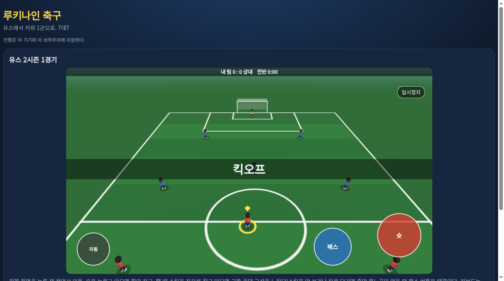
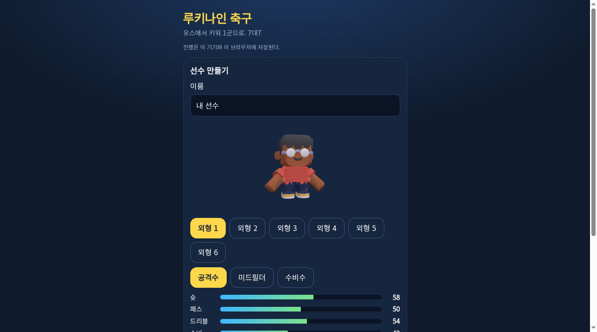
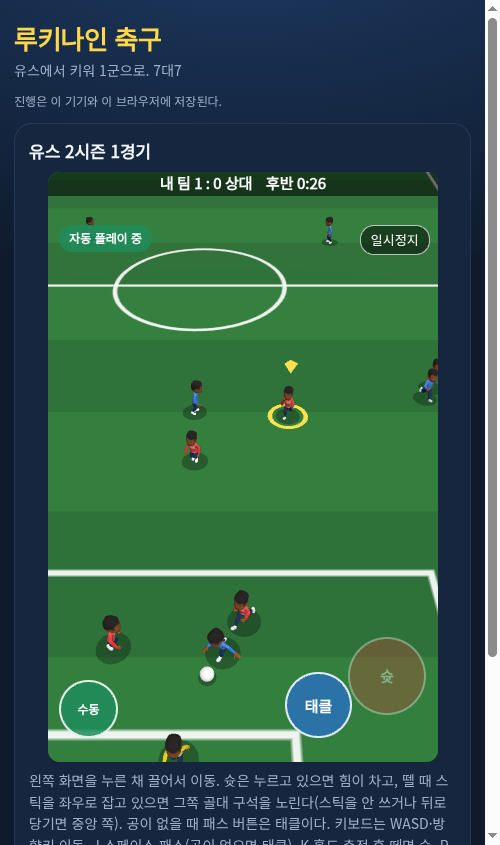
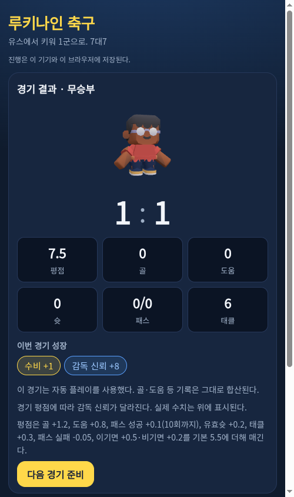
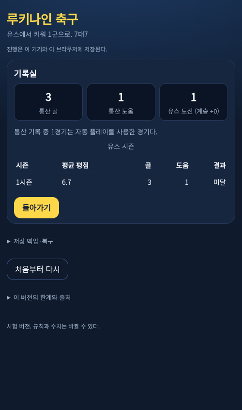

# 루키FC

구단 유스에서 선수를 키워 1군으로 승격하는 7대7 3D 축구 게임 (첫 플레이 버전, 시험용).
브라우저에서 실행되고 진행은 이 브라우저의 localStorage에 저장된다.

플레이: https://sigco3111.github.io/rookie-fc/

## 실행
    npm ci           # package-lock.json 기준 설치 (또는 npm install)
    npm run dev      # 개발
    npm run build    # docs/ 에 정적 파일 생성

## 주요 기능
- 유스 3시즌(시즌당 2경기) 육성 후 승격 평가. 미달하면 능력치 일부를 계승해 다시 도전한다.
- 승격 후에는 1군 리그(14라운드)를 치르고, 시즌이 끝나면 성장한 능력치로 다음 시즌을 이어한다.
- 경기 중 위임(자동 플레이): 좌하단 '자동' 버튼으로 경기를 AI에 맡기고, '수동'으로 언제든 되돌린다. 위임한 경기는 결과 화면과 기록실에 사용 사실이 표기되고, 골·도움 등 기록은 그대로 합산된다.
- 기록실: 통산 골·도움, 유스 시즌·1군 시즌 표, 자동 플레이 사용 경기 수를 보여 준다.
- 화면: PC(가로 700px 이상·가로가 세로보다 충분히 넓은 뷰포트)에서는 16:9 와이드로 상단 점수·시간과 경기 화면 전체를 스크롤 없이 함께 표시한다. 카메라에 잡히는 것은 경기장의 일부이며, 공을 따라 시야가 움직인다. 모바일에서는 세로 화면을 유지한다.

## 스크린샷
캡처 조건: 헤드리스 Chrome, PC 1280×800·모바일 폭 500 뷰포트, 배포 버전 기준. 모바일 경기 화면은 자동 플레이를 켠 상태다.

| 선수 만들기 | 모바일 경기(자동 플레이 중) |
| --- | --- |
|  |  |

| 결과 화면 | 기록실 |
| --- | --- |
|  |  |

## 에셋과 출처
- 경기 선수: Kenney Animated Characters Protagonists (CC0), https://kenney.nl
- 육성 화면 선수: Kenney Mini Characters (CC0, GLB 판), https://kenney.nl
  - 셔츠에 쓰인 채도 높은 보라·초록 계열 색만 음영을 유지한 채 빨강으로 바꿔 그린다. 피부, 머리, 바지와 원본 파일은 그대로다.
  - 외형 4는 female-a의 몸통을 같은 스켈레톤의 female-e 몸통으로 바꾸고, 팔 바깥으로 가는 긴 막대 부분만 화면에서 숨긴다. 얼굴·머리·애니메이션은 female-a를 유지한다.
- 글꼴: Noto Sans KR (SIL OFL 1.1), 사용한 한글만 추린 부분집합 src/models/hud.woff. 새 한글 문구를 넣으면 다시 추려야 한다.
- 킥 동작: CMU Graphics Lab Motion Capture Database (free for all uses, 데이터 재판매 금지, 출처 표기 요청), http://mocap.cs.cmu.edu/
- 3D 엔진: three.js (MIT)
- 참고만 한 프로젝트: sigco3111/soccer-3d-ko (코드와 에셋은 사용하지 않음)

## 알려진 한계
- 시험 버전이다. 밸런스와 터치 성능은 계속 조정 중이다.
- 자동 플레이 정책은 단순하다. 공을 소유하면 골문으로 돌파해 약 12m 안쪽에서 슛하고, 소유 중 패스는 하지 않는다. 상대가 가진 공에는 근접 시 스틸(패스 버튼 입력)을 시도한다.
- 확인된 환경: 헤드리스 브라우저(PC·모바일 뷰포트)와 실제 모바일 1회 확인. 모든 기기·화면 크기에서 검증된 것은 아니다.
- 과거 시험에서 경기 시계가 초기화되는 현상이 드물게 관측됐으나 원인은 확정되지 않았다.
- 이적, 재정은 없다.
